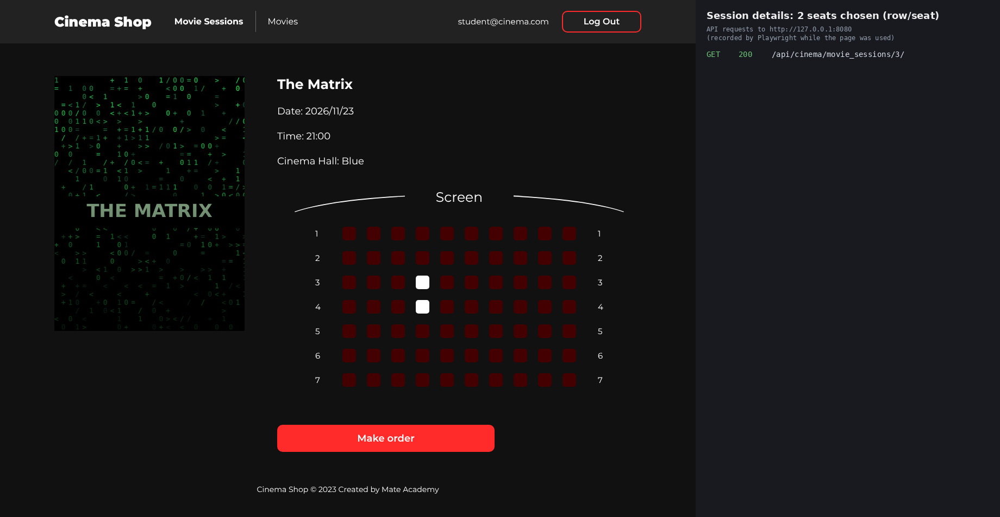

# Cinema Fullstack

- Read [the guideline](https://github.com/mate-academy/py-task-guideline/blob/main/README.md) before start

## Task:

You already have Backend and Frontend implemented.
You need to connect them together, and make sure all functionality of Cinema Shop works.

NOTE: Attach screenshots of all pages from the correctly connected frontend. Better to make them with opened developer tool, where will be shown requests to the API.

## How to run

### Backend (Django REST Framework, port 8080)

```shell
cp .env.sample .env          # fill in the POSTGRES_* values, POSTGRES_HOST=db
docker-compose up --build
```

In a second terminal create an admin (staff users see Cinema Halls,
Genres, Actors and the "+" buttons):

```shell
docker-compose exec app python manage.py createsuperuser
```

### Frontend (Vue + Vite, port 5173)

```shell
cd frontend
cp .env.sample .env          # VITE_API_URL=http://127.0.0.1:8080
npm install
npm run dev
```

Open http://localhost:5173 (or http://127.0.0.1:5173).
Both origins are allowed by `CORS_ALLOWED_ORIGINS`; if the frontend runs
anywhere else, add that origin to `CORS_ALLOWED_ORIGINS` in `.env`.

## What was changed to connect the frontend

- **CORS.** The frontend (`:5173`) and the API (`:8080`) are different
  origins, so the browser blocked every response. `django-cors-headers`
  is installed, `CorsMiddleware` is the first middleware and the allowed
  origins come from `CORS_ALLOWED_ORIGINS`.
- **Real endpoints.** The frontend was written against static mock files
  (`frontend/api/...`): URLs like `movies-1` and no trailing slashes.
  Every request now goes to `VITE_API_URL` with the router's URLs:
  `/api/cinema/movies/1/`, `/api/cinema/movie_sessions/1/`,
  `/api/cinema/movies/<id>/upload-image/`, and a trailing slash
  everywhere (Django cannot redirect a POST to the slashed URL).
- **Token refresh.** The frontend saves `access` *and* `refresh` from
  `/api/user/token/refresh/`, so `ROTATE_REFRESH_TOKENS` is on (otherwise
  `"undefined"` was stored as the refresh token). The access token lives
  30 minutes instead of 60 hours, and the app no longer tries to refresh
  every minute when nobody is logged in.
- **Frontend bugs found while testing:**
  - every show time of one movie opened the *first* session of that
    movie; each time now opens its own session;
  - the email `pattern` was an invalid regular expression in current
    Chrome (`v` flag), so `checkValidity()` threw on every input;
  - "My orders" showed 21:00 as `9:00` (`h:mm` → `HH:mm`).
- **Backend:** `wait_for_db` really opens a connection now
  (`connections["default"]` alone never fails), and one flake8 E501 line.

## Screenshots

Every page was used against the running API. The panel on the right of
each screenshot lists the API requests the page made (method, status,
URL), recorded with Playwright.

| Page | Screenshot |
| --- | --- |
| Sign in | [01-sign-in](screenshots/01-sign-in.png) |
| Sign up → token → me → movies | [02-sign-up-then-movies](screenshots/02-sign-up-then-movies.png) |
| Sign in as admin | [03-sign-in-admin-movies](screenshots/03-sign-in-admin-movies.png) |
| Genres (list + add) | [04-genres](screenshots/04-genres.png) |
| Actors (list + add) | [05-actors](screenshots/05-actors.png) |
| Cinema halls (add → list) | [06-cinema-halls](screenshots/06-cinema-halls.png) |
| Add movie form | [07-add-movie-form](screenshots/07-add-movie-form.png) |
| Movie created + image uploaded | [08-movie-created-list](screenshots/08-movie-created-list.png) |
| Movies filtered by genre | [09-movies-filter-genre](screenshots/09-movies-filter-genre.png) |
| Movie details | [10-movie-details](screenshots/10-movie-details.png) |
| Add movie session | [11-add-session-form](screenshots/11-add-session-form.png) |
| Movie sessions for a date | [12-movie-sessions-today](screenshots/12-movie-sessions-today.png) |
| Session details, seats chosen | [13-session-details-seats](screenshots/13-session-details-seats.png) |
| Order created, seats booked | [14-order-created](screenshots/14-order-created.png) |
| My orders | [15-my-orders](screenshots/15-my-orders.png) |
| Profile update | [16-profile-updated](screenshots/16-profile-updated.png) |
| Expired access token → refresh | [17-token-refresh](screenshots/17-token-refresh.png) |


