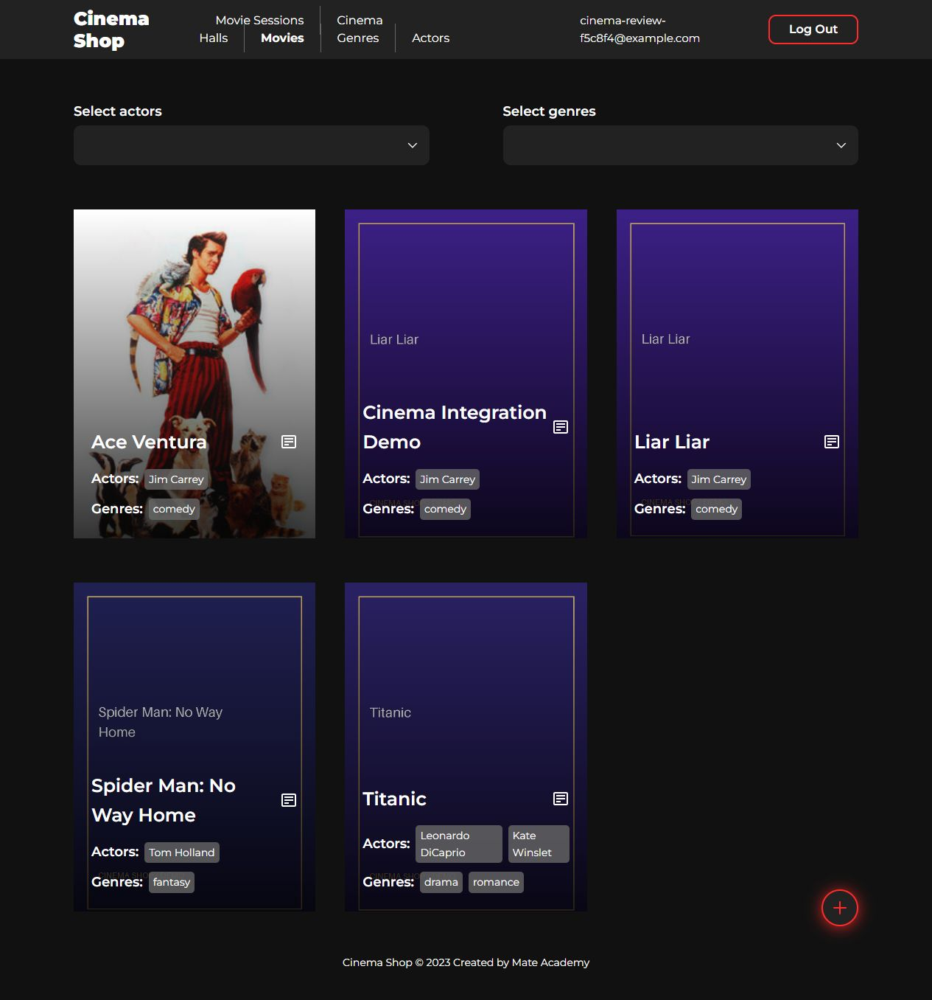
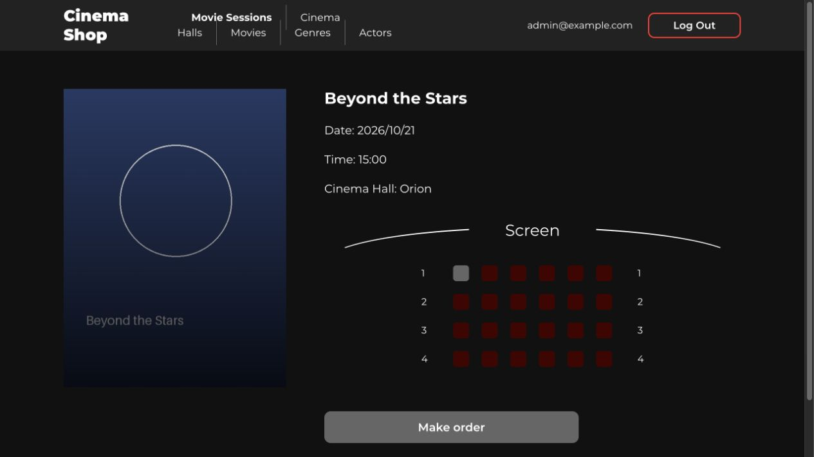

# Cinema Fullstack

A connected Cinema Shop: the supplied Vue interface uses the Django REST API for authentication, catalogue management and ticket ordering.

## Features

- Email sign-up/sign-in, JWT refresh, profile updates and local logout.
- Movie browsing, actor/genre filtering and movie detail dialogs.
- Sessions filtered by date, with each screening linked to its own seat map.
- Seat selection, atomic booking, visible occupied seats and private paginated order history.
- Staff creation of actors, genres, halls, movies, poster uploads and sessions.
- Visible API errors and session expiry handling.
- Local SQLite setup or a Docker Compose stack with PostgreSQL and persistent media/database volumes.

Mock-style detail URLs were replaced with real Django routes, including trailing slashes and multipart image upload. A shared Axios client uses one configurable API origin, retries protected requests after refreshing an expired access token and retains the existing refresh token when the server returns only a new access token. Vite proxies `/api/` and `/media/` and preserves the browser host so image and pagination URLs remain usable inside Docker.

## Local setup

Requirements: Python **3.11–3.13** and Node.js **22.20+**.

```sh
git clone -b develop https://github.com/sydneyhart/py-cinema-full-stack.git
cd py-cinema-full-stack
python -m venv venv
source venv/bin/activate
# Windows: venv\Scripts\activate
pip install -r requirements.txt
cp .env.sample .env
python backend/manage.py migrate
python backend/manage.py seed_demo --with-users
python backend/manage.py runserver 127.0.0.1:8080
```

In another terminal:

```sh
cd frontend
npm ci
cp .env.sample .env
npm run dev
```

Open **[Cinema Shop](http://localhost:5173/)**. Use one host consistently (`localhost` or `127.0.0.1`) because browser token storage is scoped to its origin.

The opt-in demo command creates three original sample movies with posters, a hall, actors/genres, and sessions for today and tomorrow. It also creates:

| Role | Email | Password |
| --- | --- | --- |
| Staff/admin | `admin@example.com` | `Cinema-demo-2026!` |
| Customer | `visitor@example.com` | `Cinema-demo-2026!` |

These public credentials are only for disposable local demos. The command does not change existing account passwords. Use `python backend/manage.py createsuperuser` for your own administrator, or register a customer through the UI. `seed_demo` without `--with-users` creates only catalogue data.

SQLite is the local default. To use an existing PostgreSQL server, set `POSTGRES_HOST`, `POSTGRES_DB`, `POSTGRES_USER` and `POSTGRES_PASSWORD` in the root `.env` before migrations. The original `sample_cinema.json` is retained as starter reference; the demo command avoids its expired sessions and missing poster files.

## Docker setup

Install Docker with Compose. From the repository root:

```sh
cp .env.sample .env
# Edit SECRET_KEY and POSTGRES_PASSWORD in .env.
docker compose up --build -d
docker compose exec app python manage.py seed_demo --with-users
```

Open [the frontend](http://localhost:5173/). The API is at [localhost:8080](http://localhost:8080/api/cinema/), Swagger at [API documentation](http://localhost:8080/api/doc/swagger/), and Django admin at [admin](http://localhost:8080/admin/).

The app starts after PostgreSQL becomes healthy, waits for a usable database connection, then applies migrations. Database and media uploads use named volumes; the backend runs as a non-root user. If startup is still applying migrations, wait for `docker compose logs app` to show the development server before seeding.

```sh
docker compose logs -f app frontend
docker compose down       # retain data
docker compose up -d      # reuse data
# docker compose down -v  # destructive reset of database and uploaded images
```

Optional `BACKEND_PORT` and `FRONTEND_PORT` environment variables change the published ports. This is a development stack using Django and Vite development servers. Public deployment needs production servers, HTTPS, `DEBUG=0`, explicit hosts/origins, separate static/media serving and private secrets.

## Configuration

The root `.env` is loaded by Django. Do not commit it. `.env.sample` documents the configuration.

| Setting | Purpose |
| --- | --- |
| `SECRET_KEY` | Django signing secret; replace the sample value |
| `DEBUG` | Local debugging/media serving (`1` locally) |
| `ALLOWED_HOSTS` | Comma-separated backend hostnames |
| `CORS_ALLOWED_ORIGINS` | Explicit frontend origins for direct cross-origin API access |
| `POSTGRES_*` | Optional local PostgreSQL / Docker database credentials |
| `MEDIA_ROOT` | Upload location; Compose uses `/vol/web/media` |

Frontend settings belong in `frontend/.env`:

- `VITE_API_URL`: leave empty for the same-origin proxy; otherwise use a backend origin such as `http://localhost:8080`, without `/api`.
- `API_PROXY_TARGET`: defaults to `http://127.0.0.1:8080`; Compose sets `http://app:8080`.

Restart Vite after changing frontend environment values. `VITE_*` variables are public browser configuration and must never contain secrets. CORS accepts only configured origins; the recommended proxy setup does not require cross-origin requests.

## Try the application

1. Sign up or sign in as a customer. Browse Movies and select actor/genre filters. Click a movie to open its details.
2. Open Movie Sessions, choose a date and click a screening time. Select available seats and press **Make order**. Booked seats become unavailable.
3. Click your email in the header to open **My orders** or **My profile**. Orders belong to the signed-in account. Update your email/password in the profile form.
4. As staff, open Genres or Actors and use the plus button to add an entry. Add a hall under Cinema Halls. Under Movies, add a movie, select actors/genres and optionally upload a PNG/JPEG poster. Add a session by selecting its movie, hall, date and time.
5. Use **Log Out** to clear browser credentials. JWT access tokens last 15 minutes; refresh tokens last one day. Logout is local and does not revoke an already issued token on the server.

The UI displays local times; API datetimes are timezone-aware. Booking occupied or invalid seats returns HTTP 400 and rolls back the entire order. Customer writes to staff-only catalogue endpoints return HTTP 403.

## Validation

```sh
python backend/manage.py test backend/cinema/tests
python backend/manage.py makemigrations --check --dry-run
flake8 backend
pip check
cd frontend
npm ci
npm run build
npx playwright install chromium
npm run test:e2e
```

The browser suite expects a running backend on port 8080 with `seed_demo --with-users` in a fresh disposable database. It starts Vite itself. The three scenarios cover customer registration/profile/booking/history/logout; staff catalogue creation and image upload; and access-token refresh/invalid-refresh recovery. Run them against disposable data because they create accounts and catalogue records.

GitHub Actions runs 26 backend tests against PostgreSQL, style/dependency/migration checks, a frontend build, all three real-browser scenarios, Docker builds and an HTTP smoke test through the Docker frontend proxy. Browser screenshots and request traces are uploaded as `browser-test-evidence` artifacts. `scripts/smoke_test.py` verifies JWT login, movie data and poster serving through the frontend origin.

The supplied frontend remains on Vue 2/v-calendar 2 for compatibility. The dependency audit still reports a low-severity Vue 2 advisory; a Vue 3 migration is separate from this integration task.

## Connected frontend screenshots

Actual local application captures, including every screen and staff creation form:

| Screen | Capture |
| --- | --- |
| Sign in | [Screenshot](screenshots/sign-in.jpg) |
| Sign up | [Screenshot](screenshots/sign-up.jpg) |
| Movies | [Screenshot](screenshots/movies.jpg) |
| Movie details | [Screenshot](screenshots/movie-details.jpg) |
| Sessions | [Screenshot](screenshots/sessions.jpg) |
| Session details / booked seats | [Screenshot](screenshots/session-details.jpg) |
| Orders | [Screenshot](screenshots/orders.jpg) |
| Profile | [Screenshot](screenshots/profile.jpg) |
| Cinema halls | [Screenshot](screenshots/halls.jpg) |
| Add hall | [Screenshot](screenshots/add-hall.jpg) |
| Genres | [Screenshot](screenshots/genres.jpg) |
| Add genre | [Screenshot](screenshots/add-genre.jpg) |
| Actors | [Screenshot](screenshots/actors.jpg) |
| Add actor | [Screenshot](screenshots/add-actor.jpg) |
| Add movie | [Screenshot](screenshots/add-movie.jpg) |
| Add session | [Screenshot](screenshots/add-session.jpg) |




Original assignment: connect the supplied frontend/backend and attach screenshots of all frontend pages. Development follows the [course task guideline](https://github.com/mate-academy/py-task-guideline/blob/main/README.md).
