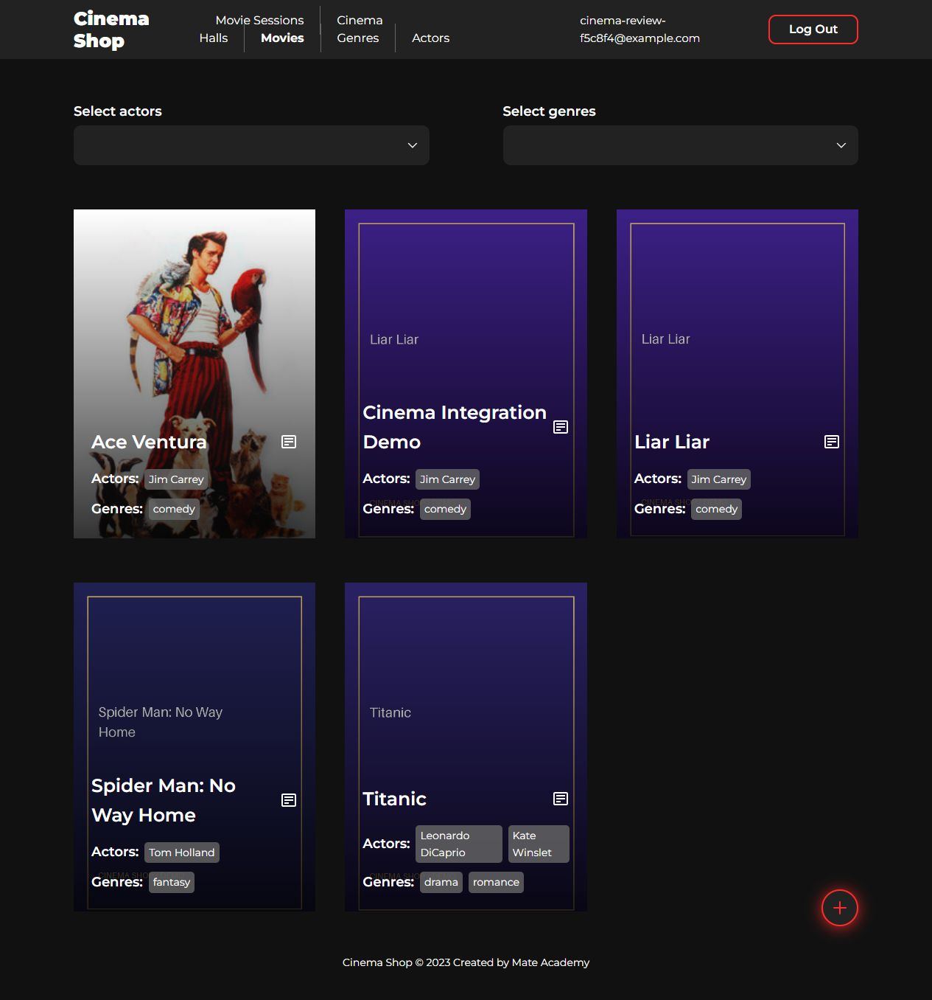
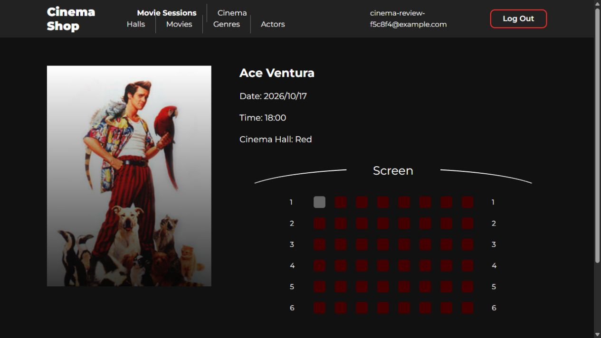
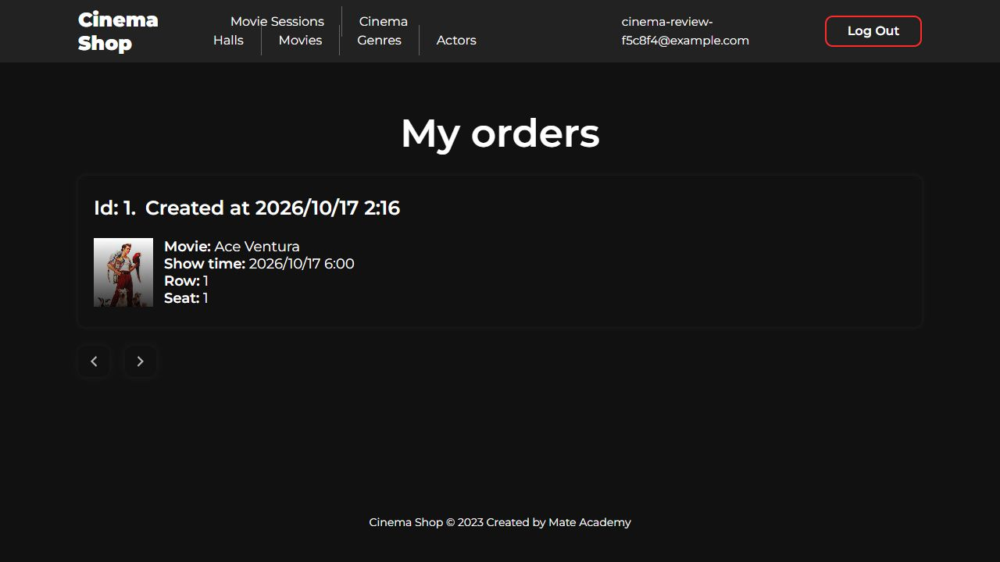

# Cinema Shop integration verification

Checked locally on 2026-10-17 against Django on port 8080 and Vue/Vite on
port 5173. These are development test accounts and demo catalog records.

## Results

- Django: **20 tests passed**, including allowed and rejected CORS preflights.
- Frontend: production build passed; ESLint passed for changed components.
- Backend changed files passed Flake8 using the repository configuration.
- Browser: registration with automatic login, login, logout, movie details,
  administrative creation of a genre, actor, hall, movie with uploaded image,
  and movie session; profile PATCH; seat booking and own orders all passed.
- Two sessions of Ace Ventura (18:00 and 20:00) open different session IDs
  (2 and 4). The selected local time is preserved when creating a session.
- Booking row 1 / seat 1 created an order, and the seat became unavailable.
- HTTP checks: catalogs, movie/session detail and orders returned 200;
  a regular customer's genre POST returned 403; that customer's orders did not
  expose the staff test account's booking.
- Refresh endpoint returned 200 twice using the same refresh token. It returns
  only an access token with rotation disabled; the client preserves refresh.
- All five catalog image URLs returned 200. Three missing fixture images use
  locally prepared artwork labelled DEMO. The original media is not part of
  the JSON fixture or this commit. Uploading an image through the movie form
  was separately verified.

## Pages

| Page | Screenshot |
| --- | --- |
| Sign in | [View](screenshots/sign-in.jpg) |
| Sign up | [View](screenshots/sign-up.jpg) |
| Movies | [View](screenshots/movies.jpg) |
| Movie details | [View](screenshots/movie-details.jpg) |
| Movie sessions | [View](screenshots/movie-sessions.jpg) |
| Session details and booking | [View](screenshots/booking.jpg) |
| Orders | [View](screenshots/orders.jpg) |
| Profile (successful update) | [View](screenshots/profile.jpg) |
| Cinema halls | [View](screenshots/cinema-halls.jpg) |
| Add cinema hall | [View](screenshots/add-cinema-hall.jpg) |
| Genres | [View](screenshots/genres.jpg) |
| Add genre | [View](screenshots/add-genre.jpg) |
| Actors | [View](screenshots/actors.jpg) |
| Add actor | [View](screenshots/add-actor.jpg) |
| Add movie with image | [View](screenshots/add-movie.jpg) |
| Add movie session | [View](screenshots/add-movie-session.jpg) |

